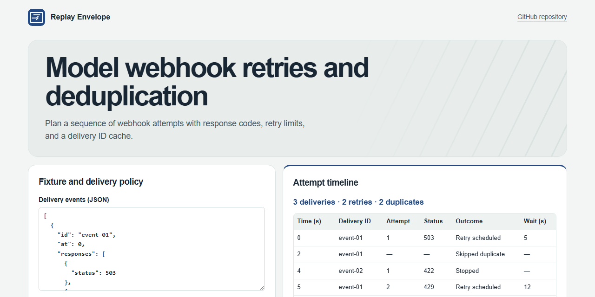

# Replay Envelope

**Model webhook retries and deduplication.** Plan a sequence of webhook attempts with response codes, retry limits, and a delivery ID cache.

[Open the live tool](https://musabukhari237.github.io/replay-envelope/) · [Report an issue](https://github.com/MusaBukhari237/replay-envelope/issues)

[](https://musabukhari237.github.io/replay-envelope/)

## Try it

Choose **Load retry example**, then **Simulate delivery**. The fixture uses seconds from an arbitrary start time. Each incoming event supplies an ID, an arrival time and mock response codes. A delivery in progress or cached after success suppresses matching arrivals.

## How it works

The simulator retries 408, 425, 429 and 5xx with exponential backoff. A mock Retry-After delay can extend the backoff. JSON export lists each attempted, suppressed or terminal event. The simulator runs entirely in the browser.

## Run locally

Clone the repo and serve the `docs` folder from localhost.

```sh
python -m http.server 8000 --bind 127.0.0.1 --directory docs
```

Open http://127.0.0.1:8000 in a current browser. Run `node --test` from the repository root with Node.js 22 or later.

## Sponsors

Supported by [LeadCeleris](https://www.leadceleris.com/) and [AIFFICIENTO](https://www.aifficiento.biz/).

## Contributing

Read [CONTRIBUTING.md](CONTRIBUTING.md) and use synthetic fixtures in issue reports. The source is available under the [MIT license](LICENSE).
